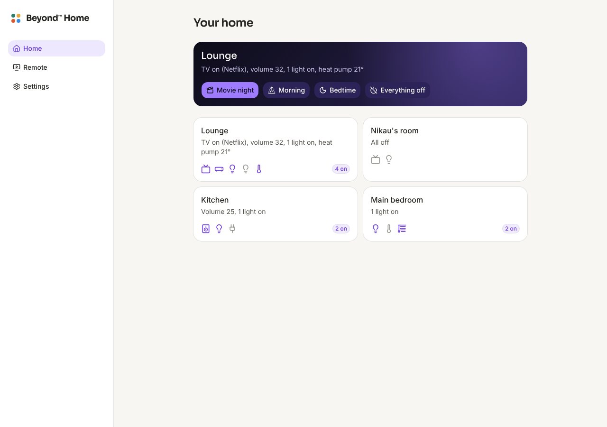

# Beyond™ Home

**Free your world.** Your whole home in plain words: one app and one remote for the TV, the sound, the lights and the heat pumps. No more ten apps and a basket of remotes.

Beyond Home is the home side of the Beyond tools, alongside [Beyond™ TV](https://github.com/YeahBuddyNZ/Beyond.TV), [Beyond™ Gateway](https://github.com/YeahBuddyNZ/Beyond-Gateway) and Beyond Family. It is [Home Assistant](https://www.home-assistant.io) underneath, the open home system that already talks to thousands of brands, with the Beyond app on top in place of Home Assistant's own screens.



## What it does today (stage 0)

- **Rooms, not devices.** Every room in one short line: "TV on (Netflix), volume 32, 1 light on, heat pump 21°".
- **One remote.** Volume goes wherever the sound is coming from: the receiver when it is on, otherwise the TV, otherwise a speaker. Power, mute and the input in the same place.
- **Moments.** Movie night (TV and receiver on, sound to the TV, lights down), Morning, Bedtime, Everything off and Party (lights bright and in colour; when Beyond TV runs a party, the colours change with its music and go back to warm white after). A room only shows the moments that fit it.
- **Each thing in the room.** On and off, lights brighter and dimmer, heat pumps warmer and cooler by half a degree.
- **Works inside the house.** Nothing goes through the internet, and every device still works with its own remote and app.
- **The way back.** Home Assistant's own screens are under *Settings*, *Advanced*, for anything Beyond Home doesn't do yet.
- **Your home on the TV.** [Beyond™ TV](https://github.com/YeahBuddyNZ/Beyond.TV) gets a Home row: every room's line, its Moments and the one remote, from the sofa. The TV finds the box by itself and shows a code; type it in *Settings*, *TVs*. Taking a TV off there stops it straight away.
- **Your music.** A *Music* tab plays the family's own albums and New Zealand radio, with a player bar that follows you round the app and the phone's lock screen buttons. The music lives on a Mac, a Raspberry Pi or this box, wherever [Beyond Music](https://github.com/YeahBuddyNZ/Beyond-Music) runs (it copies CDs too). On this box it's found by itself; for a Mac, type its address in *Settings*, *Music*. Beyond Home passes the asks along (`server/music.mjs`, its own short list of paths), so it works however Home Assistant is opened.

- **On your phone.** The Beyond Home app for iPhone finds the box on your home Wi-Fi and shows a code; type it on the box under *Settings*, *TVs and phones*, once. Then the rooms, the remote and your music are in your pocket anywhere in the house. *Forget this box* under *Settings* lets it go, and the box can take a phone off too. On an album, *Keep on this phone* copies it to the phone so it plays away from home; *Let go* takes it off, and an album taken off the box (a CD sold or given away) leaves the phone too. (Coming to TestFlight; not yet tried on a real iPhone.)

The plan, with what NZ homes have and what works without the cloud, is in [docs/plan.md](docs/plan.md).

## Installing (Home Assistant)

1. A small always-on box running Home Assistant: a Home Assistant Green, or a Raspberry Pi 5.
2. In Home Assistant: *Settings*, *Apps* (called *Add-ons* on older versions), *App store*, the three dots, *Repositories*, and add `https://github.com/YeahBuddyNZ/Beyond-Home`.
3. Install **Beyond Home** and turn on *Show in sidebar*. It builds on the box the first time, which takes a few minutes.
4. Let Home Assistant find your TV, receiver and lights (it offers them under *Settings*, *Devices*), and put each one in a room (an *Area*). Beyond Home shows them room by room.

Beyond TV talks to the box on port 8098 inside the house (Home Assistant shows it under the app's *Network* settings). It only answers addresses inside the house.

Not yet tried on a real Home Assistant box: the first one is the test.

## Trying the app without Home Assistant

```bash
cd beyond_home/web
npm install
npm run dev
```

Then open `http://localhost:5173/?preview`: a made-up house (Lounge with a TV, Yamaha receiver and heat pump, a kitchen speaker, a kid's room, a bedroom with a blind).

## The iPhone app

`app/` is a [Capacitor](https://capacitorjs.com) shell around the phone build of the web app.

```bash
cd app && npm install && npm run sync   # builds beyond_home/web in phone mode and copies it in
```

Then open `app/ios/App/App.xcodeproj` in Xcode. Xcode Cloud does the same with `app/ios/App/ci_scripts/ci_post_clone.sh`.

## Checks

```bash
sh tests/run.sh                                   # the decisions, the allow list and the server
cd beyond_home/web && npm run build:hub           # typecheck and build
cd beyond_home/web && npm run build:phone         # the phone app's build
```

## Licence

GPL-3.0 (see `LICENSE`), like the other Beyond tools. Home Assistant is Apache 2.0 and runs alongside, unchanged.
